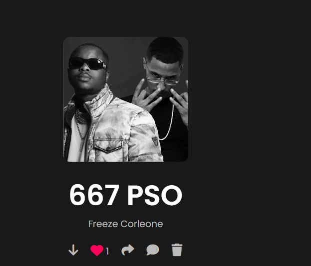
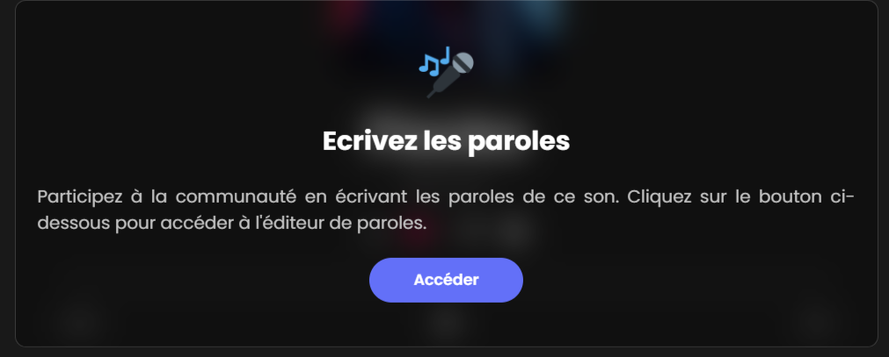
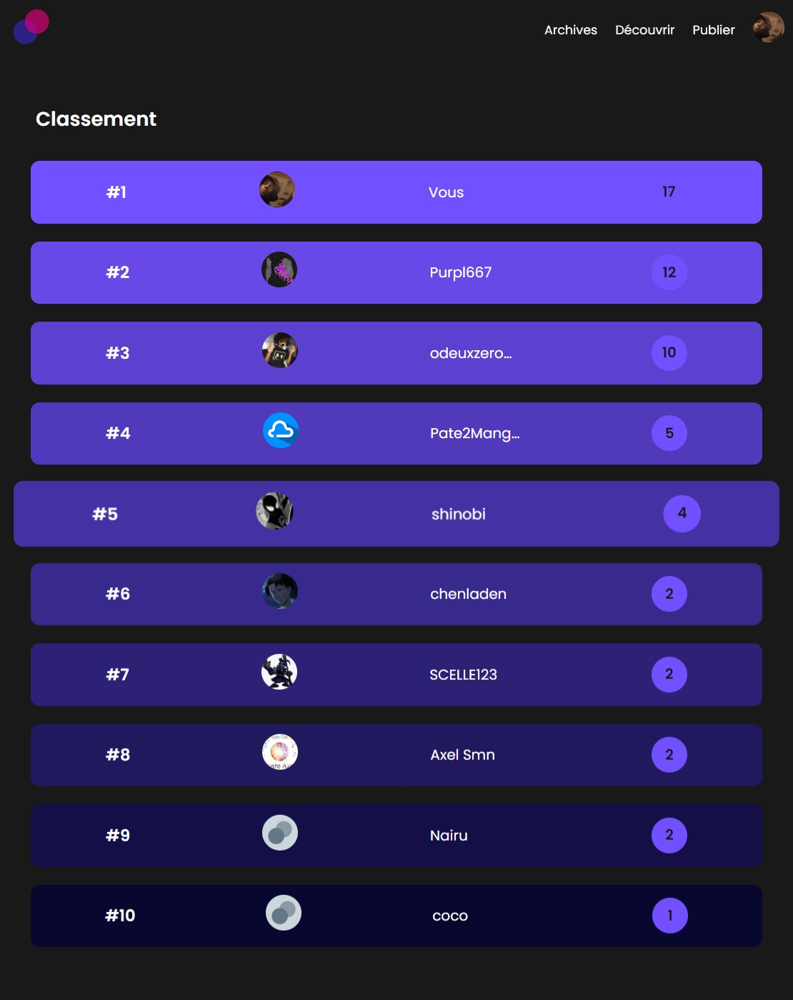
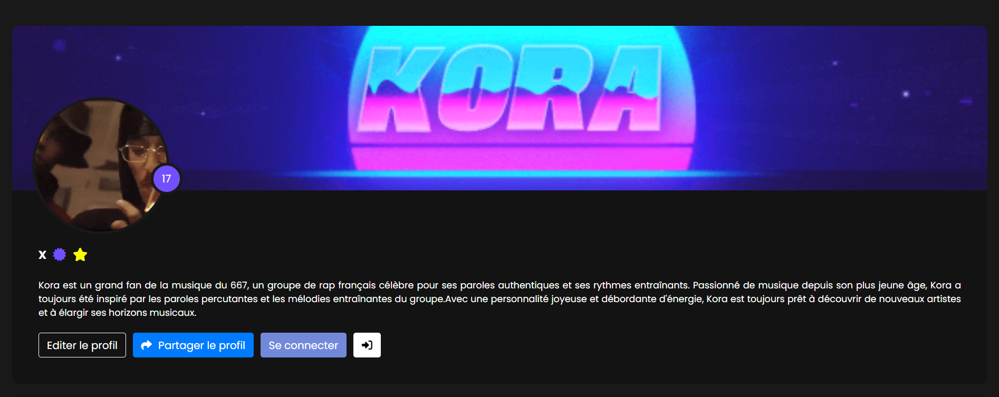

import { Image } from 'astro:assets';
import mobile from './mobile.png';

The version of ArchiveCore before [v2](#archivecore-v2). It had fewer features, but users could publish archives themselves, both tracks and images. Each track page had a player, likes, downloads, sharing, comments, similar tracks and a button to add it to a playlist.

## Synced lyrics

Its main feature was synced lyrics. Anyone could open the lyrics editor on a track, write the lyrics and sync them to the audio. Listeners then saw the lyrics follow the song, like on Spotify.

## Community

A leaderboard ranked users by how many archives they had published, and each profile showed that count next to the avatar.

## Mobile

The site was online at archivecore.fr and worked on mobile, with a bottom navigation bar.

<Image src={mobile} alt="An image archive on mobile" width={300} class="mx-auto" />
