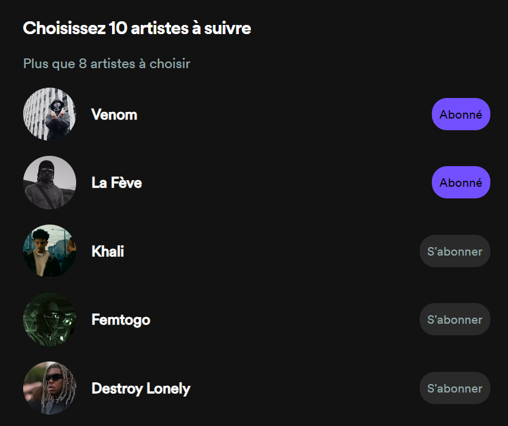
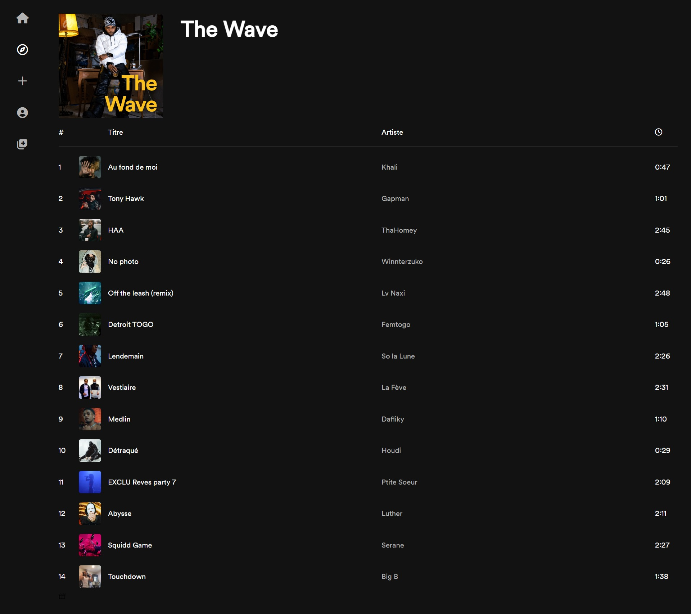
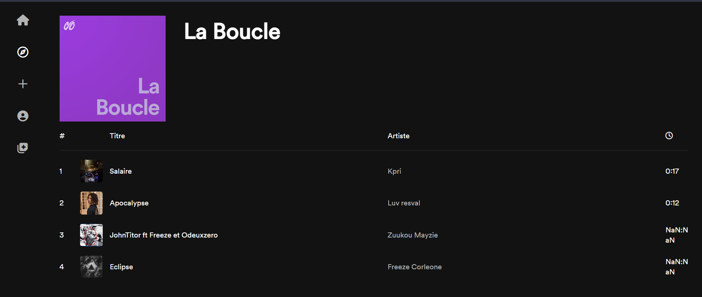
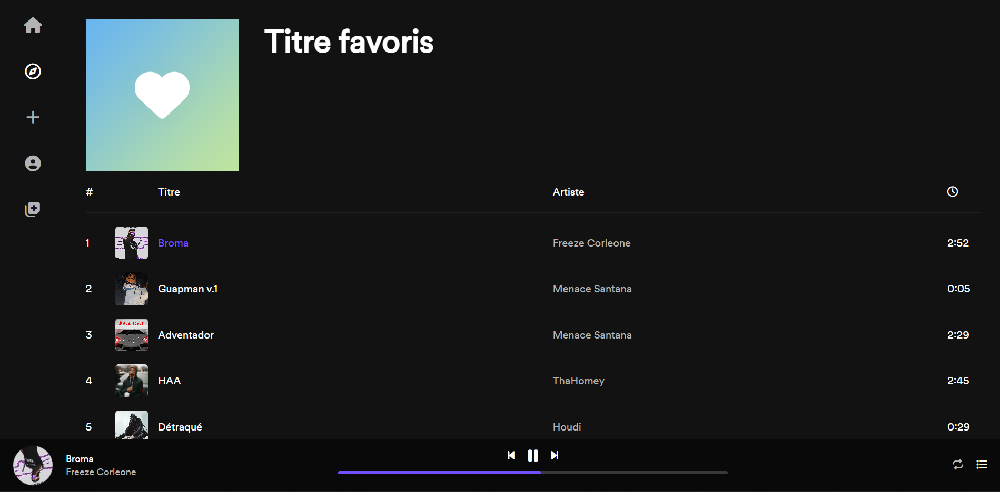
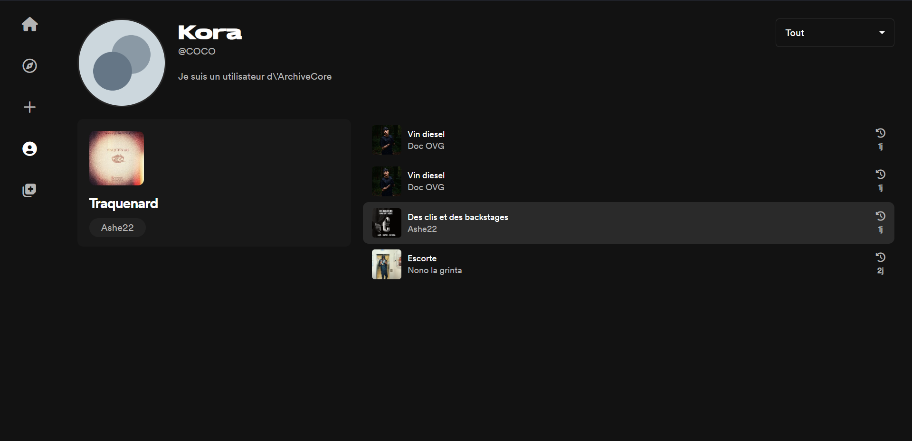
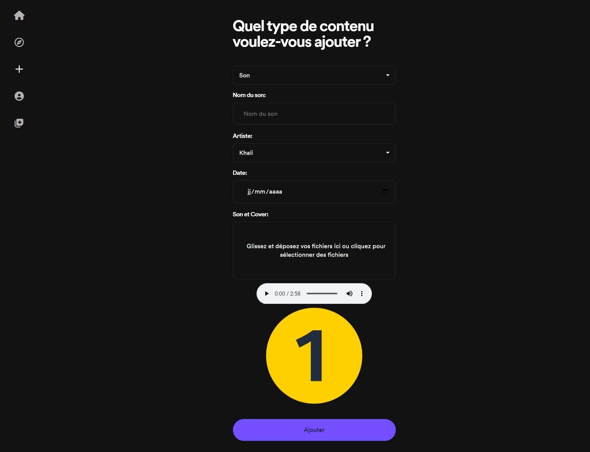

import { Image } from 'astro:assets';
import artistMobile from './artist-mobile.png';

The second version of ArchiveCore, before the [Electron app](#archivecore). It was a web app heavily inspired by Spotify, and it laid the groundwork for the next version.

## Artists

Each artist had a page with their most popular tracks and view counts, their discography, their top listeners and the tracks they were featured on. The layout also worked on mobile.

<Image src={artistMobile} alt="An artist page on mobile" width={280} class="mx-auto" />

When you signed up, you picked 10 artists to follow.

## Generated playlists

The app built playlists on its own, including one dedicated to each artist, each with its own generated cover.

## Favorites and player

You could like tracks to add them to your favorites and play them from the player bar at the bottom. The track that was playing was highlighted with a small animation.

## Profile and history

Your profile showed your recent listening history.

## Adding tracks

Tracks were added through a form with the title, the artist, the release date, the audio file and the cover.

