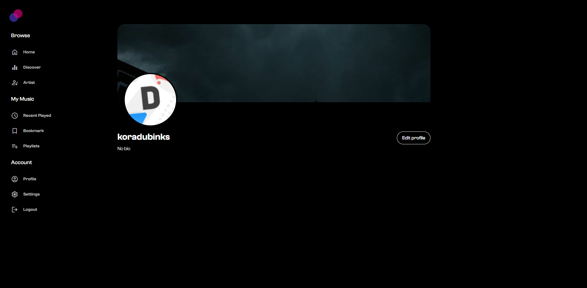

ArchiveCore was a desktop app for keeping tracks that never got an official release: songs that only exist on SoundCloud and artist exclusives. It worked like a streaming app built around those archives, with artists, albums, featurings, playlists, favorites and a listening history.

<video src="/history/archivecore/2024-08-02.mp4" controls muted playsinline></video>

## Stack

- **Desktop**: Electron with a frameless window, packaged as a Windows `.exe` installer with electron-builder and published as GitHub releases.
- **Front end**: Vue, Pinia, Vue Router and Tailwind.
- **Back end**: Express with Prisma on PostgreSQL, Argon2 for passwords, sessions and rate limiting.
- **Real time**: Socket.IO.

## Player and artists

You could subscribe to artists, play their tracks from a bottom player bar, queue songs and fetch lyrics through Genius.

<video src="/history/archivecore/2024-08-03.mp4" controls muted playsinline></video>

## Friends

You could send friend requests and see what your friends were listening to in real time, pushed over Socket.IO.

<video src="/history/archivecore/2024-08-10.mp4" controls muted playsinline></video>
