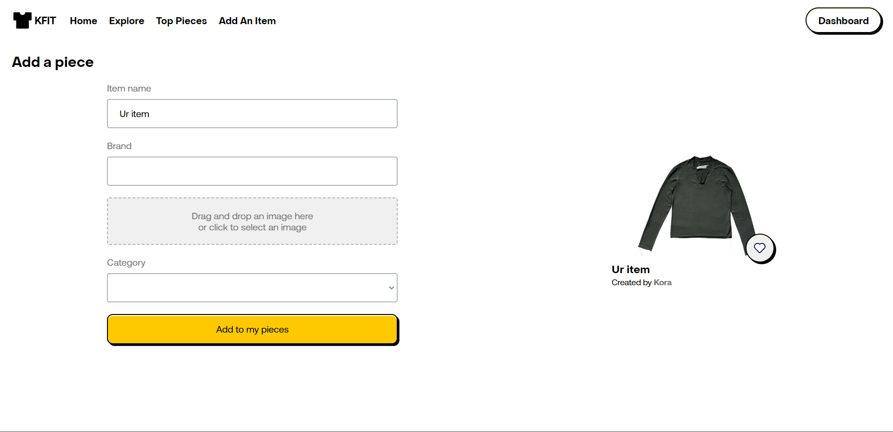

KFIT was an outfit planner. You imported your clothes as PNGs, put outfits together, exported them as PNGs and showed them on your profile, with a place to find outfit ideas.

<video src="/history/kfit/landing.mp4" controls muted playsinline></video>

## Adding a piece

## Building an outfit

<video src="/history/kfit/outfit-editor.mp4" controls muted playsinline></video>

<video src="/history/kfit/save-and-profile.mp4" controls muted playsinline></video>

## Profile

